# Restaurant POS Platform - System Flow

This diagram illustrates the complete user journey and system architecture of the restaurant POS platform.

```mermaid
graph TD
    Start([User Opens App]) --> Auth{Authenticated?}
    Auth -->|No| Login[Login/Signup Page]
    Login --> AuthCheck{Auth Success?}
    AuthCheck -->|Yes| OnboardCheck{Onboarded?}
    AuthCheck -->|No| Login
    
    Auth -->|Yes| OnboardCheck
    OnboardCheck -->|No| Onboard[Onboarding Flow]
    Onboard --> Dashboard
    OnboardCheck -->|Yes| Dashboard[Dashboard]
    
    Dashboard --> Sidebar[Sidebar Navigation]
    
    Sidebar --> Menu[Menu Management]
    Sidebar --> Tables[Tables Management]
    Sidebar --> Orders[Orders Management]
    Sidebar --> Kitchen[Kitchen Display]
    Sidebar --> Reservations[Reservations]
    Sidebar --> Staff[Staff Management]
    Sidebar --> Inventory[Inventory Management]
    Sidebar --> Customers[Customers]
    Sidebar --> Chat[Internal Chat]
    Sidebar --> Reports[Reports]
    Sidebar --> Accounting[Accounting]
    Sidebar --> Settings[Settings]
    
    Menu --> MenuDB[(Menu Items DB)]
    Menu --> Categories[Category Management]
    Categories --> CatDB[(Categories DB)]
    
    Tables --> TableDB[(Tables DB)]
    Tables --> TableStatus[Available/Occupied/Reserved]
    
    Orders --> NewOrder[Create Order]
    NewOrder --> OrderType{Order Type}
    OrderType --> DineIn[Dine In]
    OrderType --> TakeAway[Take Away]
    OrderType --> Delivery[Delivery]
    
    DineIn --> SelectTable[Select Table]
    SelectTable --> AddItems[Add Menu Items]
    TakeAway --> AddItems
    Delivery --> AddItems
    
    AddItems --> OrderDB[(Orders DB)]
    Orders --> OrderStatus[New/Preparing/Ready/Completed]
    OrderStatus --> Kitchen
    
    Kitchen --> KitchenOrders[Display Orders by Status]
    KitchenOrders --> UpdateStatus[Update Order Status]
    UpdateStatus --> OrderDB
    
    Orders --> Payment[Process Payment]
    Payment --> PaymentType{Payment Method}
    PaymentType --> Cash[Cash]
    PaymentType --> Card[Card]
    PaymentType --> MobileMoney[Mobile Money]
    PaymentType --> Split[Split Payment]
    
    Cash --> Receipt[Generate Receipt]
    Card --> Receipt
    MobileMoney --> Receipt
    Split --> Receipt
    
    Receipt --> SMS[Send SMS Receipt]
    SMS --> TwilioAPI[Twilio API]
    Receipt --> TransDB[(Transactions DB)]
    
    Reservations --> NewRes[New Reservation]
    Reservations --> Waitlist[Waitlist Manager]
    NewRes --> ResDB[(Reservations DB)]
    Waitlist --> WaitlistDB[(Waitlist DB)]
    
    Staff --> StaffList[View Staff]
    Staff --> TimeTracking[Time Tracking]
    Staff --> AddStaff[Add Staff Member]
    StaffList --> StaffDB[(Staff DB)]
    TimeTracking --> TimeDB[(Time Entries DB)]
    AddStaff --> StaffDB
    
    Inventory --> InvList[View Inventory]
    Inventory --> AddInv[Add Inventory Item]
    Inventory --> InvHistory[Inventory History]
    InvList --> InvDB[(Inventory DB)]
    AddInv --> InvDB
    InvHistory --> HistDB[(History DB)]
    
    Customers --> CustList[View Customers]
    Customers --> AddCust[Add Customer]
    CustList --> CustDB[(Customers DB)]
    AddCust --> CustDB
    
    Chat --> ChatWindow[Chat Messages]
    Chat --> ChatContacts[Contact List]
    ChatWindow --> ChatDB[(Chat Messages DB)]
    
    Reports --> SalesReport[Sales Reports]
    Reports --> TimeReport[Time Reports]
    Reports --> TransHistory[Transaction History]
    Reports --> CashRecon[Cash Reconciliation]
    SalesReport --> TransDB
    TimeReport --> TimeDB
    TransHistory --> TransDB
    
    Accounting --> SalesChart[Sales Chart]
    Accounting --> Expenses[Expenses List]
    Accounting --> ExpReport[Export Report]
    Expenses --> ExpDB[(Expenses DB)]
    
    Settings --> Profile[Profile Settings]
    Settings --> Business[Business Settings]
    Settings --> POS[POS Settings]
    Settings --> Tax[Tax Settings]
    Settings --> Features[Feature Management]
    Settings --> Roles[Role Management]
    
    Features --> FeatDB[(Feature Settings DB)]
    Roles --> RolesDB[(User Roles DB)]
    Business --> BizDB[(Business Profiles DB)]
    
    style Dashboard fill:#4f46e5,color:#fff
    style Auth fill:#dc2626,color:#fff
    style Payment fill:#059669,color:#fff
    style Kitchen fill:#ea580c,color:#fff
```

## How to Use This Diagram

1. **Copy the mermaid code** above and paste it into:
   - [Mermaid Live Editor](https://mermaid.live)
   - Any markdown viewer that supports mermaid
   - Draw.io (with mermaid plugin)
   - VS Code (with mermaid preview extension)

2. **Export options** from Mermaid Live Editor:
   - PNG image
   - SVG vector
   - PDF document

## Key Components

- **Authentication Flow**: Login → Onboarding → Dashboard
- **Core Features**: Menu, Tables, Orders, Kitchen, Payments
- **Management**: Staff, Inventory, Customers, Reservations
- **Analytics**: Reports, Accounting, Charts
- **Communication**: Internal Chat, SMS Receipts
- **Configuration**: Settings, Roles, Features
